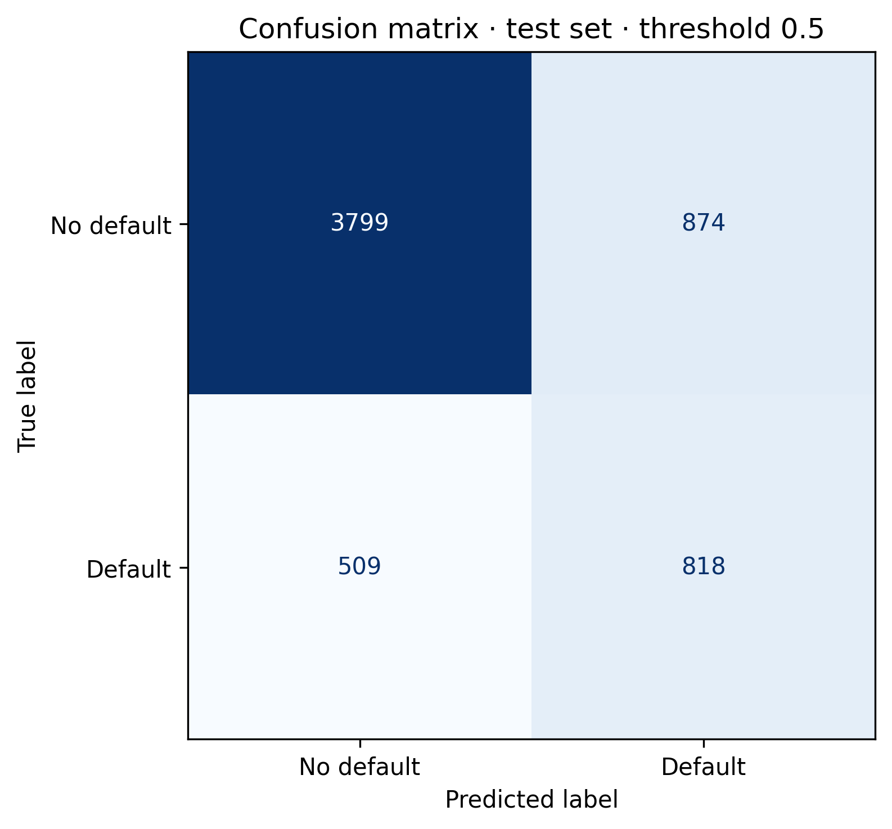
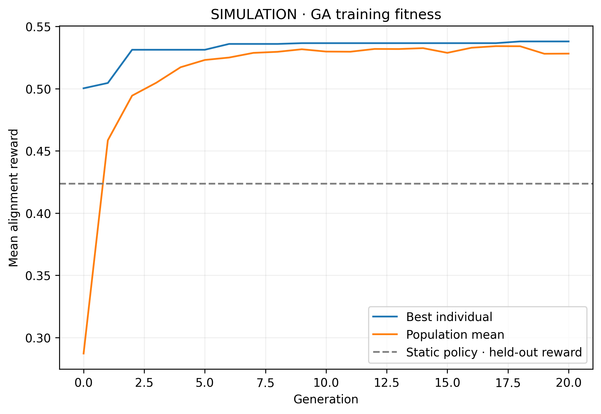

# KETE - Erklärbare KI für die Kreditberatung

**Capstone-Projekt im MSc-Studiengang Wirtschaftsinformatik**

Prototyp zur Untersuchung von Kreditrisikoprognosen, Erklärbarkeit, Fairness und menschlichem Feedback.

KETE unterstützt die Kreditberatung mit einer Einschätzung des Zahlungsausfallrisikos, einer Erklärung der Vorhersage und einer Handlungsempfehlung. Beraterinnen und Berater können die Empfehlung überprüfen und Feedback erfassen. Ein genetischer Algorithmus untersucht, wie sich Entscheidungsschwellen anhand dieses Feedbacks anpassen lassen.

Der Prototyp trifft **keine realen Kreditentscheidungen**. Seine Ergebnisse dienen der experimentellen Untersuchung und ersetzen weder eine fachliche Kreditprüfung noch einen Fairness- oder Compliance-Nachweis.

---

## Auf einen Blick

| Bestandteil | Umsetzung im Prototyp |
|---|---|
| **Datenbasis** | UCI-Datensatz «Default of Credit Card Clients» mit historischen Kreditkartendaten und Zahlungsausfall im Folgemonat |
| **Risikomodell** | CatBoost schätzt für einen Fall das Risiko eines Zahlungsausfalls |
| **Erklärbarkeit** | SHAP zeigt, welche Merkmale die Vorhersage eines Falles beeinflussen |
| **Empfehlung** | Feste Schwellenwerte ordnen einen Risikowert `APPROVE`, `REVIEW` oder `DECLINE` zu |
| **Menschliches Feedback** | Eine Streamlit-Oberfläche erfasst Beraterentscheidungen und Gründe; SQLite speichert das Feedback |
| **Optimierung** | Ein genetischer Algorithmus optimiert zwei Entscheidungsschwellen anhand der Übereinstimmung mit Beraterentscheidungen |
| **Fairness** | Gruppenvergleiche untersuchen unter anderem Falsch-Positiv-Raten nach Geschlecht und Altersgruppe |

Der [Datensatz des UCI Machine Learning Repository](https://archive.ics.uci.edu/dataset/350/default+of+credit+card+clients) umfasst 30’000 Beobachtungen aus Taiwan. Er enthält keine vollständigen Angaben zu Einkommen, Lebenshaltungskosten oder Sicherheiten und bildet eine Schweizer Kreditwürdigkeitsprüfung daher nur eingeschränkt ab.

## So funktioniert KETE

```text
Historische Kreditdaten
        │
        ▼
CatBoost-Risikomodell ───────► SHAP-Erklärung
        │
        ▼
Entscheidungsschwellen ──────► Bewilligen / Prüfen / Ablehnen
        │
        ▼
Kundenberatung ──────────────► Entscheidung und Feedback
        │
        ▼
Genetischer Algorithmus ─────► Offline-Kandidat mit neuen Schwellen
        │
        ▼
Evaluation ──────────────────► Übereinstimmung, Prüfaufwand und Gruppenvergleich
```

Das CatBoost-Modell und die Entscheidungspolitik erfüllen unterschiedliche Aufgaben. CatBoost liefert einen Risikoscore; die Policy übersetzt diesen in eine Empfehlung. Bei der genetischen Optimierung bleibt das Risikomodell unverändert. Die neue Policy wird offline ausgewertet und nicht automatisch aktiviert.

## Ergebnisse der Untersuchung

### Kreditrisikomodell

Die folgenden Werte stammen aus der Auswertung des gespeicherten CatBoost-Modells auf dem zurückgehaltenen UCI-Testdatensatz. Für Recall und Precision wurde ein Klassifikationsschwellenwert von **0,5** verwendet; die positive Klasse ist «Zahlungsausfall im Folgemonat».

| Kennzahl | Ergebnis |
|---|---:|
| Recall für Zahlungsausfälle | 61,6 % |
| Precision für Zahlungsausfälle | 48,3 % |
| ROC-AUC | 0,778 |
| Average Precision | 0,560 |
| Brier Score | 0,178 |
| Brier Score der konstanten Baseline | 0,172 |

Das Modell erkennt damit einen Teil der Zahlungsausfälle, erzeugt aber auch Fehlalarme. Sein Brier Score ist höher als jener der konstanten Prognose anhand der Ausfallhäufigkeit im Trainingsdatensatz. Eine Kalibrierung der Wahrscheinlichkeiten ist daher ein sinnvoller nächster Schritt. Eine logistische Regression wurde nicht als Baseline trainiert.



Die [Precision-Recall-Kurve](doc/abbildungen/catboost_precision_recall.png), [ROC-Kurve](doc/abbildungen/catboost_roc.png), [Kalibrierungskurve](doc/abbildungen/catboost_kalibrierung.png) und der [Trainingsverlauf](doc/abbildungen/catboost_trainingsverlauf.png) ergänzen die Konfusionsmatrix.

### Explorative Fairness-Auswertung

Bei einem Schwellenwert von 0,5 beträgt die Falsch-Positiv-Rate auf den Testdaten **17,3 % für Frauen** und **20,9 % für Männer**. Sie beschreibt den Anteil der Fälle ohne tatsächlichen Zahlungsausfall, die vom Risikomodell fälschlicherweise als Ausfall eingestuft werden. Die Analyse betrachtet auch Altersgruppen; deren Grenzen wurden für diese explorative Auswertung festgelegt.

Der Vergleich zeigt Unterschiede, erklärt aber nicht deren Ursachen und ist für sich genommen kein Diskriminierungs- oder Fairnessnachweis. Die Klassifikation des Risikomodells entspricht nicht unmittelbar einer realen Ablehnung. Ergänzend wurden die SHAP-Beiträge der Merkmale Geschlecht und Alter gruppenweise beschrieben. Diese Modellbeiträge sind keine kausalen Effekte; beide Merkmale werden im trainierten Modell verwendet.

[Grafik zu den Falsch-Positiv-Raten](doc/abbildungen/fairness_falsch_positiv_raten.png) · [Tabellen und Hinweise](reports/fairness/README.md)

### Hypothetische Kundenberatersimulation

Für den Versuch wurden 1’000 Fälle aus dem Trainingspool des CatBoost-Modells ausgewählt. Eine **simulierte** Beratung entscheidet anhand von Zahlungsverzug und Kreditauslastung; mit 5 % Wahrscheinlichkeit wird zufällig eine andere Entscheidung gewählt. Die Regeln sind hypothetische Annahmen und bilden keine validierte Bankpraxis ab.

Der genetische Algorithmus optimiert anhand von 800 Fällen. Die übrigen 200 Fälle werden für die Policy-Evaluation zurückgehalten; sie sind jedoch Teil des Trainingspools des Risikomodells. Das Ergebnis ist daher kein neuer unabhängiger Test von CatBoost.

| Kennzahl auf den 200 Policy-Testfällen | Statische Policy | GA nach 1 Generation | GA nach 20 Generationen |
|---|---:|---:|---:|
| Übereinstimmung mit simulierter Beratung | 59,0 % | 60,5 % | 63,0 % |
| Durchschnittlicher Reward | 0,424 | 0,445 | 0,492 |
| Anteil manueller Prüfungen | 16,0 % | 13,5 % | 0,5 % |

Nach 20 Generationen steigt die Übereinstimmung, während die Review-Rate stark sinkt. Das weist auf einen möglichen Fehlanreiz der gewählten Reward-Funktion hin: Eine übereinstimmende Prüfung wird geringer belohnt als eine übereinstimmende Bewilligung oder Ablehnung. Die Ergebnisse stammen aus einem einzelnen Zufallsstart und belegen weder geringere Kreditausfälle noch fairere Entscheidungen.



Weitere Abbildungen: [Evaluationsvergleich](doc/abbildungen/ga_evaluationsvergleich.png), [Schwellenwerte](doc/abbildungen/ga_schwellenwerte.png) und [Entscheidungswechsel](doc/abbildungen/ga_entscheidungswechsel.png).

## Projekt starten

Voraussetzungen sind Python, eine virtuelle Umgebung und die Pakete aus `requirements.txt`. Für den ersten Download des Datensatzes ist eine Internetverbindung erforderlich.

```bash
python -m venv .venv
source .venv/bin/activate       # macOS / Linux
pip install -r requirements.txt
streamlit run ui/app.py
```

Unter Windows wird die Umgebung mit `.venv\Scripts\activate` aktiviert. Ohne trainiertes Modell und vorhandenen UCI-Testsplit zeigt die Anwendung synthetische Demofälle. Deren Risikoscore und Erklärungsfaktoren sind Demonstrationen und keine CatBoost-/SHAP-Auswertung.

Um CatBoost auf den UCI-Daten zu trainieren:

```bash
python -m src.ml.train_credit_model --iterations 500
streamlit run ui/app.py
```

Das Training lädt den Datensatz bei Bedarf herunter, erstellt stratifizierte Trainings-, Validierungs- und Testdaten und speichert Modell und Metadaten unter `models/`. Die beste Trainingsiteration wird anhand der Validierungs-ROC-AUC ausgewählt. Eine systematische Hyperparametersuche oder Optimierung des Klassifikationsschwellenwerts ist nicht Teil dieses Trainings.

## Experimente und Auswertungen

Im Tab **Data science experiments** zeigt die Anwendung Modellkennzahlen und die Offline-Optimierung der Policy. Für die Optimierung werden mindestens zehn verschiedene Anträge mit gespeichertem Entscheidungssnapshot und demselben Modell-/Policy-Kontext benötigt. Pro Antrag wird das letzte Feedback verwendet. Ein so kleiner Datensatz dient einem technischen Test; seine Evaluation erlaubt keine belastbare Aussage.

Die Auswertungen können auch über die Kommandozeile erstellt werden:

```bash
# CatBoost-Abbildungen und Kennzahlen
python -m src.evaluation.report

# Fairness-Gruppenvergleich und SHAP-Tabelle
python -m src.evaluation.fairness_report

# Hypothetische Beratersimulation: eine bzw. 20 Generationen
python -m src.evaluation.simulate_advisor --generations 1 --output reports/ga_simulation_one_generation
python -m src.evaluation.simulate_advisor --generations 20

# Tests
python -m pytest -q
```

Die Skripte setzen das gespeicherte Modell und die verarbeiteten UCI-Daten voraus und schreiben generierte Auswertungen nach `reports/`. Die Simulation schreibt nicht in die Feedbackdatenbank und aktiviert keine Policy. Der vorhandene vollständige Export liegt zusätzlich als [Modell-ZIP](reports/kete_appendix.zip), [Fairness-ZIP](reports/fairness.zip), [GA-ZIP für eine Generation](reports/ga_simulation_one_generation.zip) und [GA-ZIP für 20 Generationen](reports/ga_simulation.zip) vor. Tabellen, Laufkonfigurationen und Interpretationshinweise bleiben ebenfalls unter `reports/` erhalten.

## Was der Prototyp leistet – und was noch offen ist

- Feedbackgründe können erfasst werden, werden aber bei der aktuellen genetischen Optimierung **nicht** als Eingabe verwendet. Der Zusatznutzen begründeten Feedbacks wurde noch nicht nachgewiesen.
- Die GA-Fitness misst die Übereinstimmung mit Beraterentscheidungen und den festgelegten Reward. Sie misst keine tatsächliche Verbesserung von Rückzahlungen.
- Der Datensatz enthält historische Kreditkartendaten aus einem begrenzten Zeitraum. Eine zufällige Datenaufteilung belegt keine Übertragbarkeit auf zukünftige Kunden oder andere Länder.
- SHAP erklärt Beiträge zur Modellvorhersage; es belegt keine Ursachen. Die Gruppenanalyse liefert beschreibende Hinweise und keinen umfassenden Fairnessnachweis.
- Nächste Schritte sind aktuellere Daten, zusätzliche geeignete Finanzmerkmale, Kalibrierung, eine systematische Hyperparametersuche, weitere Gruppenanalysen sowie mehrere Zufallsstarts und eine Überarbeitung der Reward-Funktion.

## Projektstruktur

```text
├── doc/abbildungen/       Ausgewählte Abbildungen für Projektdokumentation und Anhang
├── src/
│   ├── data/              Laden und Aufteilen des UCI-Datensatzes
│   ├── ml/                CatBoost-Training, Vorhersage und SHAP-Erklärungen
│   ├── evolutionary/      Entscheidungspolicy und genetische Optimierung
│   ├── feedback/          Erfassung und Speicherung von Feedback
│   ├── fairness/          Fairness-Hilfsfunktionen
│   ├── evaluation/        Modell-, Fairness- und Simulationsauswertungen
│   └── rl/                Reward-Funktionen
├── ui/                    Streamlit-Anwendung
├── tests/                 Automatisierte Tests
├── reports/               Generierte Auswertungen, Tabellen und vollständige Exporte
├── requirements.md        Ursprüngliche Projektspezifikation
└── requirements.txt       Python-Abhängigkeiten
```

Lokale Datensätze, trainierte Modelle und Feedbackdatenbanken werden bei Bedarf erzeugt und sind teilweise von Git ausgeschlossen.

## Kleines Glossar

| Begriff | Bedeutung im Projekt |
|---|---|
| **Baseline** | Einfaches Vergleichsverfahren, etwa die konstante Prognose anhand der Ausfallhäufigkeit im Training. |
| **Brier Score** | Misst die mittlere quadratische Abweichung zwischen vorhergesagten Wahrscheinlichkeiten und tatsächlichen Ergebnissen; kleiner ist besser. |
| **CatBoost** | Modell aus Entscheidungsbäumen, das hier das Zahlungsausfallrisiko schätzt. |
| **Falsch-Positiv-Rate** | Anteil der Fälle ohne Zahlungsausfall, die fälschlicherweise als Ausfall klassifiziert werden. |
| **Genetischer Algorithmus (GA)** | Suchverfahren, das Kandidaten über Generationen mithilfe von Selektion, Kreuzung und Mutation verbessert. |
| **Human-in-the-Loop** | Menschen überprüfen Empfehlungen und geben Entscheidungen oder Feedback in den Prozess ein. |
| **Policy** | Regel, die den Risikoscore anhand von Schwellenwerten in eine Handlungsempfehlung übersetzt. |
| **Precision** | Anteil tatsächlicher Ausfälle unter den als Ausfall klassifizierten Fällen. |
| **Recall** | Anteil der tatsächlichen Ausfälle, die als Ausfall erkannt werden. |
| **Reward** | Festgelegtes Bewertungssignal für die Übereinstimmung zwischen Empfehlung und Beraterentscheidung. |
| **SHAP** | Verfahren zur Beschreibung der Beiträge einzelner Merkmale zu einer Modellvorhersage. |
| **Schwellenwert** | Grenzwert, ab dem ein Score einer bestimmten Klasse oder Empfehlung zugeordnet wird. |

---

MSc Wirtschaftsinformatik · Capstone-Projekt · Prototyp zur erklärbaren Kreditentscheidung
